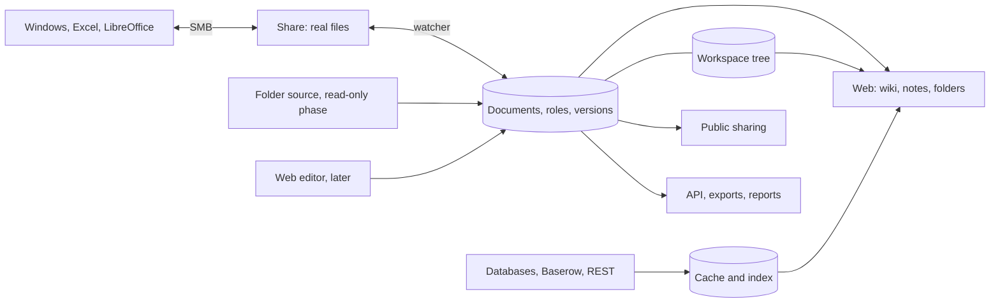

# UnderDoc concept

Status: proposal. Decisions are recorded in [`backlog/`](../backlog/), which wins if the two disagree.

## Goal

All knowledge lives in one place. Pages are made of blocks that can always be exported as Markdown, media is only embedded, and
every fact has exactly one source.
People who want Excel keep Excel on a share, and the web shows the same file.

## Principles

Every feature is checked against these before it is built, see [ADR-17](../backlog/ADR-17-guiding-principles.md).

- **The same action gets the same reaction, everywhere.** A click opens only this, Ctrl with a click adds to a selection, a
  click on anything with children opens them, and a right click opens the menu of what is under the pointer.
- **Everything is an object** with a stable ID, its own address and a way to be embedded elsewhere, down to a table or a
  paragraph inside a page ([ADR-18](../backlog/ADR-18-object-ids-and-addresses.md)).
- **One source per fact,** also for parts of a document: embed, never copy.
- **Phone and desktop are both first-class,** with the same objects and actions and a layout of their own each.
- **Built later means greyed out, switched off means gone.**

## Core idea: documents with an owner, folders only arrange them

A document has its own identity, type, roles and versions. Where it sits is a separate layer, so moving a document changes
where it appears, not what it is. See [ADR-13](../backlog/ADR-13-documents-and-folders.md) and
[ADR-15](../backlog/ADR-15-workspace-of-typed-documents.md).

- **Roles:** one owner (person or group), plus editors, commenters and viewers, per person or group.
- **Pages live in the database as blocks**, each with its own ID, and Markdown is the way in and out
  ([ADR-19](../backlog/ADR-19-pages-in-the-database.md)). An Excel file stays the exact file, kept under its hash. Every version is
  kept.
- **Who sees what before roles:** shared collections for everyone signed in, private ones for their user, and for all others edit,
  comment or read, inherited down the tree ([ADR-20](../backlog/ADR-20-who-sees-what-before-roles.md)).
- **The share is a projection:** chosen folders appear as real files. Changes from there become new versions.
- **Way out:** `underdoc export` writes everything as normal files at any time.

## Embedding: pages only reference their sources

| Object | Source of truth in the read-only phase | Embedding in Markdown (proposal) |
|---|---|---|
| Page | `.md` file with an `id:` in its front matter | `[[Page]]`, resolved by ID |
| File | File in the folder | `![[plan.pdf]]` |
| Excel table | Named table in an `.xlsx` | `::sheet{file="tower.xlsx" table="dimensions"}` |
| Snippet | File `_snippets/customers.sql` | `::snippet{id="customers"}` |
| Value | `_values.yaml`, optionally a named Excel cell | `{{tower.height}}` renders as “50 m” |
| Source, view | `_sources/*.yaml`, credentials only from the environment | `::view{id="open-tickets"}` |
| Native list | Database, with web editing | `::view{list="contacts" filter="customer=4711"}`, `{{customers:4711.phone}}` |
| Password | Encrypted store, never in Markdown | `::secret{id="router-admin"}` |

- **In the read-only phase everything comes from a folder source**, so a single source works without an editor.
- **Every object shows “used in”.** That makes a change predictable.
- **A missing value is a visible error** plus an entry in a list of broken references, never a silent gap.
- A view can take its SQL from a snippet, so documentation and table share one query.
- Embedding has a depth limit and cycle detection.
- “My notes” is a private collection per user.

## Ideas taken from other tools

Concepts only. No code, text, translations or assets from these tools, see [ADR-1](../backlog/ADR-1-build-instead-of-fork.md).

| Idea | Seen in | In UnderDoc |
|---|---|---|
| Notebook, section, page | OneNote | Top folder, folder, page. No free placement on the page |
| Table of contents next to the page | Outline, Docmost | M-1 |
| Backlinks | Outline | M-1 |
| Search field on `/` and Ctrl+K | Outline | M-1, a command palette in M-12 |
| Recently changed | Outline | M-1 |
| Page history and restoring | Outline, Docmost, OneNote | M-2 |
| Public share links | Outline, Docmost | M-5 |
| Comments | Outline, Docmost | M-5 |
| Favorites, recently viewed | Outline | M-16 |
| Slash menu, templates | Outline, Docmost | M-8 |
| Quick notes without choosing a place | OneNote | M-8 |
| Diagrams in the page | Docmost | Mermaid in M-3, drawing in M-11 |
| Tags that can be searched, text in images | OneNote | M-12 |
| Collections above a tree that is mostly open | OneNote | M-14 |
| Documents side by side | Code editors | M-15 |
| Tabs with find on the page, source view and word count | Text editors | M-15 |
| Quick notes as cards on a board | Google Keep | M-8 |
| Kanban board | Many | M-6 |
| IP addresses, VLANs and devices | NetBox | M-23 |
| Bookmarks with an import from the browser | Browsers | M-25 |
| News from subscribed feeds | Feed readers | M-26 |
| An assistant next to the open document | Many | M-13 |
| Mentions with an inbox | Confluence | M-16 |
| Calendars in the wiki | Confluence | M-18, as a view of existing dates |
| Review, comments and issues on changes | Code forges | M-20, on the forge itself |
| Pages under pages | Outline, Confluence | M-14, for every document type |
| Site builder from sections | Google Sites | M-21 |

## Workspace

A small shell holds everything, and modules plug into it ([ADR-14](../backlog/ADR-14-one-topic-at-a-time.md)). Variants
are clicked through as mockups before any of this is built (T-5), and the choice is in
[ADR-16](../backlog/ADR-16-how-the-workspace-works.md).

Three views on one set of objects ([ADR-15](../backlog/ADR-15-workspace-of-typed-documents.md)):

| View | Shows | Example |
|---|---|---|
| **Workspace** | My collections and hierarchy, arranged as I want | A page with a table and an Excel file below it |
| **Files** | The folder structure on the disk or share, not strictly one to one | The folder with the images |
| **Resources** | What has no place in a folder, and every database and view | Values, snippets, connections, external sources |

- **Document types:** folder, page, table, to-do list, kanban board, Excel file, PowerPoint file, video, image collection, quick notes,
  saved search, IP range, device list, database view, database, and later site. Each is a module.
- **Hierarchy:** any document can have children. A folder is a document without content, with its own icon and with roles like
  any other document.
- **Three columns:** every view uses nav1 for the view, nav2 for the section and nav3 for the list. Their edges can be dragged, and a
  column pushes the ones to its right. Nav1 and nav2 snap to icon, icon with text below, text, and icon with text beside it. The private
  views and the profile sit at the bottom of nav1, and the profile holds the settings and the administration. The name, New and the
  search field sit above the columns, and the tabs share that row. Menus float over the lists, so nothing below them
  moves.
- **One rule for clicks:** as a rule nav1 opens nav2, nav2 opens nav3, nav3 opens into the active window. Everything has its own
  right-click menu.
- **Collections:** favorites sit in nav2, and Collections lists all of them in nav3 with stars and gears. A click opens only that one, a double
  click keeps one open, and Ctrl with a click selects several, to move them or open them together. Open ones stack in nav3. Documents open by themselves up to a set number of children. A plus adds a
  document, which is then dragged to its place.
- **Tabs:** every window has a general tab, always its first, and a list opens into the one of the active window. The next document
  replaces it, the older ones show as a stack with an arrow to list the last 15, and dragging it keeps the document as a tab of its
  own. Dragging sorts tabs, and they
  snap into place. A right click offers what code editors offer: close others, close to the right, close all, close the window.
- **Windows:** one column by default. Dragging a tab to the left or right third of a window opens a new column there, up to four, with a
  preview first. A window goes with its last tab, and the active one has a line along its top.
- **Head:** the heading is not part of the content. Title, description, dates and tags sit above it with the breadcrumbs.
- **Document tools:** all on one level below the tabs: contents, find on the page, source view, split, gear and more, with a word count below.
- **Gear at the document:** contents, width, tags and metadata stay behind it, and are stored per document. Contents are a marker,
  a side panel or hidden. Width is slim, wide or full, where full uses all the room in its window. Content starts at the left, next
  to the navigation.
- **Modules:** an administrator switches them on and off in the administration, such as mail or a document type. Off means gone, with no
  data touched.
- **New:** always lands in a chosen collection or in Quick notes, and typing is enough.
- **Private:** views only their user can see, with to-dos, calendar, time clock, vacation planning and notes, each with its own
  lists in nav2.
- **Files** lists the user's own folder, the share and later more sources. **Bookmarks** and **News** are views of their own.
- **Metadata:** name, type, both locations, who created it, who can see it, and what it uses: external and internal links, internal
  data, values, databases. It grows with each module.
- **Tags:** every object can carry them, and a click lists what carries one.

## Two kinds of data

Some data can simply be changed: a save becomes the current version. Other data, such as code, needs someone to review and
confirm a change. The starting recommendation is a self-hosted forge next to UnderDoc, such as Forgejo, so review and issues
stay there instead of being rebuilt here, and nobody needs a GitHub account (T-7).

## Order of work

One topic at a time. Each starts with a talk with the maintainer and closes with its acceptance. Numbers are IDs, not an order.

| Block | Milestones | Why here |
|---|---|---|
| 1. Reading and first build | M-1, M-28, M-14, M-15 | Finish what exists, then sign-in, accounts, collections and documents as objects with a first part of the shell, then the rest of the shell. M-28 brings the database forward |
| 2. Foundation | M-2, M-3 | Database, versions, files and Excel, which is the biggest technical risk, then values and snippets |
| 3. People | M-5, M-16 | Roles before anything shared or connected, so they are not added afterwards |
| 4. Editing | M-6, M-8, M-10, M-20 | Tables first, as they need no JavaScript toolchain, then the editor, working together and review |
| 5. Connected data | M-4, M-9, M-18, M-19 | Sources under real roles, then inline editing, calendar and forms |
| 6. In and out | M-7, M-17 | API, reports, WebDAV, import and export |
| 7. Extras | M-21, M-11, M-12, M-13, M-22, M-23, M-24, M-25, M-26, M-27 | Site builder, drawing, proper search, AI, mail, network documentation, private area, bookmarks, news, more file sources |

The order can change between topics, not during one. M-12 in particular can move forward once there is enough to search.

## Building blocks

| Part | Choice | Reason |
|---|---|---|
| Server | Go | One binary, strong standard library |
| Read-only UI | `html/template`, HTMX, C22 design system | No JS toolchain, strict CSP possible |
| Markdown | goldmark with custom directives | Extensible |
| Reading Excel | excelize | Reads stored results, calculates nothing itself |
| Database | Postgres | Native lists, full-text search, many writers |
| Sign-in | TinySesam as a gate in front | OIDC, SAML, LDAP, group mapping, independent of language |
| Editor (later) | TipTap, Yjs, Hocuspocus | Existing parts, check each package's license |
| Excel in the browser (optional, later) | Collabora via WOPI | Check its limits first |
| Review and issues (optional, later) | Forgejo as a separate service, to be decided in T-7 | Self-hosted, with an API |

## Excel and the share

- **Desktop Excel on SMB has no co-authoring.** One person writes, others read. Real parallel work needs native lists
  or the later browser route.
- **Editing starts in the folder.** Open the file in Excel or LibreOffice. The web shows its path with a copy button.
- **Office saves through renames.** The watcher waits for quiet, ignores temp and lock files (`~$…`, `.~lock.…#`),
  validates the ZIP before reading and shows the last good version on failure. The inode is no identity.
- **Moves in Explorer:** the same hash at a new path counts as a move of the same document, anything else as “orphaned”.
- **Addresses:** named tables and named cells are stable, `A1:D20` drifts.
- **Files not written by Excel** may lack stored formula results, which the UI marks.
- **Version history:** the server keeps a copy of every change, which a bare share lacks. See [Versions and audit](#versions-and-audit).
- **The watcher only sees local disks.** A local Samba share uses inotify, a remote file server uses polling.
- **Limit:** whoever cannot reach the share can only read and download until inline editing arrives.

## Lists

- **Every list has one source of truth:** native list, Excel file or external source, never two. Moving from Excel to
  native is a one-time import.
- **Field types:** text, number, date, choice, e-mail, phone, file, and **links to other lists**.
- **Web editing from the start**, as a deliberate exception to read-only first, using server-rendered forms and HTMX.
- **For Excel users:** a scheduled export to the share, marked as a read-only copy, with no way back.
- **Storage:** one JSONB record per row plus a link table, with history for every change.
- **Personal data:** permissions per list, audit log, deletion that includes history and exports, backup retention.
- **Deliberately not a CRM:** no sales pipeline, no mail campaigns.

## Diagrams

- **Mermaid** lives as text in the Markdown, served from our own origin.
- Values and snippets work inside diagrams: `{{router.ip}}` is replaced and escaped before rendering.
- For network topologies, `flowchart` with `subgraph` is the stable base, since `architecture-beta` is still in beta.
- **Open question:** Mermaid's inline styles may conflict with a strict CSP. To test: nonces, or rendering in an
  isolated frame. D2 is the fallback, as it renders on the server.
- **Later:** mind maps through Mermaid, drawing through Excalidraw and draw.io, stored as files in the folder.

## Passwords in the text

- **The value never enters Markdown.** It would otherwise sit in clear text on the share, in search, in versions,
  exports and backups. The text holds only the reference `::secret{id="…"}`.
- **Storage:** encrypted in the database with a key from the environment, using a maintained library such as age.
- **Separate permission per password.** Reading the page is not enough. The value arrives from the server on click,
  never in the page HTML, and every reveal is logged.
- **Never included** in search, exports, reports, public shares or the API.
- **Warning** when Markdown looks like it contains a password.
- **Honest limit:** whoever holds the server and the key can read everything. This is convenient operations
  documentation, not a vault. End-to-end encryption with groups is out of scope.

## Permissions

- **Roles belong to the document:** owner, editor, commenter, viewer. Folders pass default roles on to their contents. The
  default is no access.
- **A move changes inherited roles only**, and the UI says so first. Ownership can be transferred, and a group can be the owner.
- **Two doors, one model:** the web and SMB must agree. The app is the source of truth and derives Samba permissions
  from it. Owner and editor can write, commenter and viewer can read, and commenting only exists in the web.
- **Unproven:** whether per-file rights survive Office saving through renames (T-1). If not, share-enabled folders
  fall back to rights per folder, and the UI says so.
- **SMB cannot use OIDC.** Windows access needs a domain (AD, Kerberos) or a separate share password per user.
  Without a domain that means NTLMv2, which Microsoft lists as deprecated, although it keeps working for now.
- **Embedding bypasses nothing:** without permission on an embedded view, the reader sees “no access”.
- **Public sharing:** its own path with a token, optional expiry and password. All embedded objects are listed and
  released explicitly. Public pages only show frozen data, never a live query.
- **Sources:** queries run only on the server, with read-only accounts, time and row limits and a target allowlist.

## Versions and audit

Who changed what and when, on every door, from M-2 on. See [ADR-11](../backlog/ADR-11-versions-and-audit.md).

- **What and when:** every change is a stored version with hash, path, size and time. Deleted files can be restored.
- **Who:** the app knows the user for web, WebDAV and check-out. For SMB, Samba's `vfs_full_audit` logs user, IP, operation
  and file, and the app matches that to the version. Otherwise it says “user unknown” rather than guessing.
- **Native lists** keep a history per row.
- **Limits:** quick saves can merge into one version, and root on the server can alter the log.
- **Personal data:** retention is configurable, and employers must check their own rules before using it.

## Ways to reach the files

| Door | For whom | Limits |
|---|---|---|
| SMB with a password per user | Windows on a local network | Not for the internet, NTLMv2 without a domain |
| SMB in a domain | Companies that allow the join | Needs approval from their IT |
| WebDAV over HTTPS, served by the app | Outside the network, macOS, Linux, rclone | The Windows WebClient service is deprecated and off by default |
| Check-out in the browser | Anyone, without a client | Manual: download, edit, upload |

| Platform | Way | Note |
|---|---|---|
| Windows | SMB on the network, otherwise rclone with WebDAV | |
| Linux | SMB or WebDAV | |
| Android | Web, plus a file manager app with WebDAV or SMB | No offline sync |
| iOS | Web, plus an app with WebDAV. Check whether the Files app reaches SMB | No offline sync |

All doors end in the same permission model. See [ADR-10](../backlog/ADR-10-file-access-doors.md).

## Operation

One instance per customer, no tenants in the code. That avoids the most expensive class of bug, data crossing
customer boundaries. Web server and Samba on one host is the simplest setup.

## Search and AI, later

- **Search:** Pages, file contents, tables, lists and cached views, showing only what the reader may read. PostgreSQL
  first, a separate service only if measurements call for it ([M-12](../backlog/M-12-search.md)).
- **AI:** Optional and off by default, with a configurable and possibly self-hosted model. It only draws on what the asking
  user may read, names its sources and never sees passwords ([M-13](../backlog/M-13-ai.md)).

## Risks

1. **Scope:** this is a wiki, a list tool, a file server and a calendar in one, next to a code forge. Every milestone must be
   usable on its own, one is open at a time, and what a good tool already does stays there (issues, groupware, CRM).
2. **SMB identity** differs per environment.
3. **The share next to a real-time editor:** open sessions and outside changes collide. Solved in M-10, with a per-page lock until then.
4. **Markdown round trip:** the editor must not lose directives. Test before M-8.
5. **Keeping the share and the store in step:** the projection is the most delicate part of the model and needs tests for every failure.
6. **Two trees:** the workspace and the files can confuse, and they can disagree on permissions (T-9).
