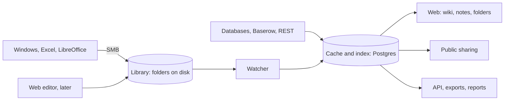

# UnderDoc concept

Status: proposal. Decisions are recorded in [`backlog/`](../backlog/), which wins if the two disagree.

## Goal

All knowledge lives in one place. Pages are Markdown, media is only embedded, and every fact has exactly one source.
People who want Excel keep Excel on a share, and the web shows the same file.

## Core idea: objects with a source, pages only embed

| Object | Source of truth in the read-only phase | Embedding in Markdown (proposal) |
|---|---|---|
| Page | `.md` file with an `id:` in its front matter | `[[Page]]`, resolved by ID |
| File | File in the folder | `![[plan.pdf]]` |
| Excel table | Named table in an `.xlsx` | `::sheet{file="tower.xlsx" table="dimensions"}` |
| Snippet | File `_snippets/customers.sql` | `::snippet{id="customers"}` |
| Value | `_values.yaml`, optionally a named Excel cell | `{{tower.height}}` renders as “50 m” |
| Source, view | `_sources/*.yaml`, credentials only from the environment | `::view{id="open-tickets"}` |
| Native list | Database, with web editing | `::view{list="contacts" filter="customer=4711"}`, `{{customers:4711.phone}}` |
| Password | Encrypted store, never in Markdown | `::secret{id="router-admin"}` |

- **In the read-only phase everything is a file**, so a single source works without an editor.
- **Every object shows “used in”.** That makes a change predictable.
- **A missing value is a visible error** plus an entry in a list of broken references, never a silent gap.
- A view can take its SQL from a snippet, so documentation and table share one query.
- Embedding has a depth limit and cycle detection.
- Wiki, notes and folders are **one tree with three lenses**. “My notes” is a private library per user.

## Building blocks

| Part | Choice | Reason |
|---|---|---|
| Server | Go | One binary, strong standard library |
| Read-only UI | `html/template`, HTMX, C22 design system | No JS toolchain, strict CSP possible |
| Markdown | goldmark with custom directives | Extensible |
| Reading Excel | excelize | Reads stored results, calculates nothing itself |
| Database | Postgres | Native lists, full-text search, many writers |
| Sign-in | TinySesam as a gate in front | OIDC, SAML, LDAP, group mapping, independent of language |
| Editor (later) | TipTap, Yjs, Hocuspocus | Existing parts, check each package's license |
| Excel in the browser (optional, later) | Collabora via WOPI | Check its limits first |

## Excel and the share

- **Desktop Excel on SMB has no co-authoring.** One person writes, others read. Real parallel work needs native lists
  or the later browser route.
- **Editing starts in the folder.** Open the file in Excel or LibreOffice. The web shows its path with a copy button.
- **Office saves through renames.** The watcher waits for quiet, ignores temp and lock files (`~$…`, `.~lock.…#`),
  validates the ZIP before reading and shows the last good version on failure. The inode is no identity.
- **Moves in Explorer:** the same hash at a new path counts as a move, anything else as “orphaned”.
- **Addresses:** named tables and named cells are stable, `A1:D20` drifts.
- **Files not written by Excel** may lack stored formula results, which the UI marks.
- **Version history:** the server keeps a copy of every change, which a bare share lacks. See [Versions and audit](#versions-and-audit).
- **The watcher only sees local disks.** A local Samba share uses inotify, a remote file server uses polling.
- **Limit:** whoever cannot reach the share can only read and download until inline editing arrives.

## Lists

- **Every list has one source of truth:** native list, Excel file or external source, never two. Moving from Excel to
  native is a one-time import.
- **Field types:** text, number, date, choice, e-mail, phone, file, and **links to other lists**.
- **Web editing from the start**, as a deliberate exception to read-only first, using server-rendered forms and HTMX.
- **For Excel users:** a scheduled export to the share, marked as a read-only copy, with no way back.
- **Storage:** one JSONB record per row plus a link table, with history for every change.
- **Personal data:** permissions per list, audit log, deletion that includes history and exports, backup retention.
- **Deliberately not a CRM:** no sales pipeline, no mail campaigns.

## Diagrams

- **Mermaid** lives as text in the Markdown, served from our own origin.
- Values and snippets work inside diagrams: `{{router.ip}}` is replaced and escaped before rendering.
- For network topologies, `flowchart` with `subgraph` is the stable base, since `architecture-beta` is still in beta.
- **Open question:** Mermaid's inline styles may conflict with a strict CSP. To test: nonces, or rendering in an
  isolated frame. D2 is the fallback, as it renders on the server.
- **Later:** mind maps through Mermaid, drawing through Excalidraw and draw.io, stored as files in the folder.

## Passwords in the text

- **The value never enters Markdown.** It would otherwise sit in clear text on the share, in search, in versions,
  exports and backups. The text holds only the reference `::secret{id="…"}`.
- **Storage:** encrypted in the database with a key from the environment, using a maintained library such as age.
- **Separate permission per password.** Reading the page is not enough. The value arrives from the server on click,
  never in the page HTML, and every reveal is logged.
- **Never included** in search, exports, reports, public shares or the API.
- **Warning** when Markdown looks like it contains a password.
- **Honest limit:** whoever holds the server and the key can read everything. This is convenient operations
  documentation, not a vault. End-to-end encryption with groups is out of scope.

## Permissions

- Inherited down the tree: library, folder, page. Roles: read, edit, manage. The default is no access.
- **Two doors, one model:** the web and SMB must agree. The app is the source of truth and derives Samba permissions
  from it. SMB only knows folders, so share-enabled libraries have permissions down to folder level, and the UI says so.
- **SMB cannot use OIDC.** Windows access needs a domain (AD, Kerberos) or a separate share password per user.
  Without a domain that means NTLMv2, which Microsoft lists as deprecated, although it keeps working for now.
- **Embedding bypasses nothing:** without permission on an embedded view, the reader sees “no access”.
- **Public sharing:** its own path with a token, optional expiry and password. All embedded objects are listed and
  released explicitly. Public pages only show frozen data, never a live query.
- **Sources:** queries run only on the server, with read-only accounts, time and row limits and a target allowlist.

## Versions and audit

Who changed what and when, on every door, from M-2 on. See [ADR-11](../backlog/ADR-11-versions-and-audit.md).

- **What and when:** every change is a stored version with hash, path, size and time. Deleted files can be restored.
- **Who:** the app knows the user for web, WebDAV and check-out. For SMB, Samba's `vfs_full_audit` logs user, IP, operation
  and file, and the app matches that to the version. Otherwise it says “user unknown” rather than guessing.
- **Native lists** keep a history per row.
- **Limits:** quick saves can merge into one version, and root on the server can alter the log.
- **Personal data:** retention is configurable, and employers must check their own rules before using it.

## Ways to reach the files

| Door | For whom | Limits |
|---|---|---|
| SMB with a password per user | Windows on a local network | Not for the internet, NTLMv2 without a domain |
| SMB in a domain | Companies that allow the join | Needs approval from their IT |
| WebDAV over HTTPS, served by the app | Outside the network, macOS, Linux, rclone | The Windows WebClient service is deprecated and off by default |
| Check-out in the browser | Anyone, without a client | Manual: download, edit, upload |

| Platform | Way | Note |
|---|---|---|
| Windows | SMB on the network, otherwise rclone with WebDAV | |
| Linux | SMB or WebDAV | |
| Android | Web, plus a file manager app with WebDAV or SMB | No offline sync |
| iOS | Web, plus an app with WebDAV. Check whether the Files app reaches SMB | No offline sync |

All doors end in the same permission model. See [ADR-10](../backlog/ADR-10-file-access-doors.md).

## Operation

One instance per customer, no tenants in the code. That avoids the most expensive class of bug, data crossing
customer boundaries. Web server and Samba on one host is the simplest setup.

## Search and AI, later

- **Search:** Pages, file contents, tables, lists and cached views, showing only what the reader may read. PostgreSQL
  first, a separate service only if measurements call for it ([M-12](../backlog/M-12-search.md)).
- **AI:** Optional and off by default, with a configurable and possibly self-hosted model. It only draws on what the asking
  user may read, names its sources and never sees passwords ([M-13](../backlog/M-13-ai.md)).

## Risks

1. **Scope:** this is a wiki, a list tool and a file server in one. Every milestone must be usable on its own.
2. **SMB identity** differs per environment.
3. **Files as truth versus a real-time editor:** open sessions and outside changes collide. Solved in M-10, with a per-page lock until then.
4. **Markdown round trip:** the editor must not lose directives. Test before M-8.
